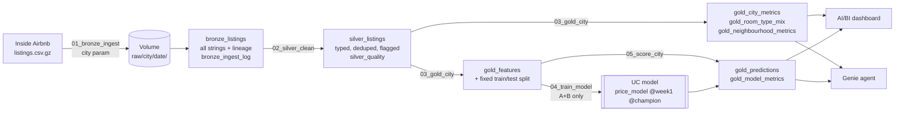

# Team Roalda — Airbnb price analytics (US South)

| Role | City | Inside Airbnb slug | Snapshot date |
|---|---|---|---|
| City A (training) | New Orleans, LA | `new-orleans` | TODO (from `bronze_ingest_log`) |
| City B (training) | Asheville, NC | `asheville` | TODO |
| City C (new client) | Nashville, TN | `nashville` | TODO (week 2) |

Region: **US South**, currency **USD**. Data: [Inside Airbnb](https://insideairbnb.com/get-the-data/) `listings.csv.gz`, CC BY 4.0.
Runs entirely on Databricks Free Edition (serverless), at no cost.

**Why Nashville as city C:** a large, event-driven market (concerts, group and bachelorette trips) whose mix of large group listings and price levels likely differs from both training cities, so it tests whether the pipeline and model transfer.

## Architecture



- **Bronze** — the published file, unchanged: every column a string, plus `city`, `snapshot_date`, `source_file`, `ingested_at`. Purpose: replay without re-downloading.
- **Silver** — one row per listing, typed with `try_cast`, deduplicated, with quality flags (`price_flag`, `is_monthly`, `room_type_known`) instead of silent drops. `silver_quality` records per-city data-quality numbers.
- **Gold** — what consumers need: metrics for the dashboard and Genie, model features with a fixed split, predictions and model metrics.

All tables live in `workspace.airbnb` and are partitioned by `city`; every write replaces only its own city, so runs are idempotent and cities are independent.

## Repository

```
notebooks/
  common.py            config, helpers, feature list, baseline (shared; no city-specific code)
  00_eda_A_B.py        exploratory analysis + leakage review (cities A and B only)
  01_bronze_ingest.py  download + land raw file          (param: city, snapshot_date, download)
  02_silver_clean.py   type, clean, flag                  (param: city)
  03_gold_city.py      metrics + features + split         (param: city)
  04_train_model.py    baseline, CV model choice, test-set evaluation, UC registration
  05_score_city.py     predictions for any city           (param: city, model_alias, run_label)
jobs/jobs.yml          Job 1 per-city pipeline, Job 2 week-1 run, Job 3 new city
```

## How to run

1. In Databricks: **Workspace → Create → Git folder** with this repository.
2. Create **Job 1** (`airbnb_city_pipeline`) from `jobs/jobs.yml`, replace `<REPO>`. Note its job id.
3. Create **Job 2** (`airbnb_train_week1`), replace `<REPO>` and `<JOB_1_ID>`, run it. It runs the pipeline for New Orleans and Asheville, trains, and scores both.
4. Run `00_eda_A_B` and fill in its summary and the snapshot dates above.
5. If the download is blocked, upload `listings.csv.gz` to `/Volumes/workspace/airbnb/raw/<city>/<YYYY-MM-DD>/` and run Job 1 with `download=false`.

Week 2 only: create **Job 3** and run it with `city=nashville`, `model_alias=week1`, `run_label=c_first_run`.

## Model (week 1)

- Target: `price` (USD/night on the snapshot date); trained on log price, converted back.
- Split: deterministic 80/20 by hash of listing `id`, per listing, fixed in gold before any modelling.
- Baseline: median training price by `room_type × accommodates` (fallback: room type, then global).
- Model choice: 5-fold CV on training rows among Ridge and gradient boosting variants; evaluated once on test.
- Features: size (accommodates, bedrooms, beds, bathrooms, shared bath), distance to city centre, minimum nights, amenities, host, reviews, room and property type. Excluded for leakage: `estimated_revenue_l365d`, `review_scores_value`, availability, estimated occupancy (see EDA §6).

| Test-set MAE (USD) | New Orleans | Asheville | A + B |
|---|---|---|---|
| Baseline | TODO | TODO | TODO |
| Model | TODO | TODO | TODO |

## City C report (week 2)

| | MAE (USD) |
|---|---|
| Baseline on city C | TODO |
| Model on A + B (test) | TODO |
| Model on city C, first run (`week1`) | TODO |
| Model on city C, after changes | TODO |

**First run:** did it run? what failed? what came out?

| # | Change | Kind (pipeline fix / model change) | Reason |
|---|---|---|---|
| 1 | | | |

## Team contributions

| Member | Contribution |
|---|---|
| | |
